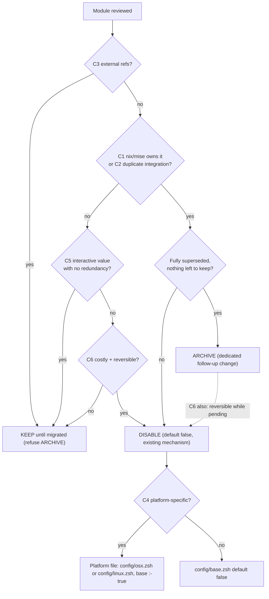

# Design

## Context

Loader reality (verified): `zsh/zshrc` sources `zsh/system/*` at `:27-40` (skip `core`, disable check at `:35`), bootstraps + sources `$CUSTOMRC` at `:43-49`, then glob-sources `zsh/modules/*` at `:56-66` (disable check at `:60`) — both checks use only `ZSH_DISABLED_MODULES`. Three consumers of that variable exist: `zshrc:35`, `zshrc:60`, and `zsh/system/core/pkg/helper/tmux.zsh:22-24` (the tmux helper runs BEFORE `$CUSTOMRC` is sourced — known limitation, unchanged here). PATH/FPATH dedupe lives at `:77-84`. `mise activate zsh` runs twice: unconditional at `zsh/zshrc:121` and guarded by `core::exists mise` in `zsh/modules/devops/internal/mise.zsh:4-11` (evaluated at source time `:49`). `atuin init zsh` is likewise duplicated: unconditional `zshrc:116` vs the guarded devops loader. All 40 modules expose `ZSH_<MODULE>_ENABLED="${ZSH_<MODULE>_ENABLED:-true}"` in `config/base.zsh` except `tmux` (`:-false`); six platform disables already exist (alacritty/hyprland/mpd/waybar in `config/osx.zsh`; hammerspoon/osx in `config/linux.zsh`). nix ownership evidence: `nix/darwin/home.nix` packages (`lazygit bat eza zoxide fzf`, `nix-direnv`), `nix/versions.nix` pins python/node/go/terraform. See proposal.md for motivation; the behavior contract lives in `specs/zsh-module-lifecycle/` and the `devops-mise` delta.

## Goals / Non-Goals

**Goals:**

- One durable, criteria-driven classification (ARCHIVE / DISABLE / KEEP) for all 40 modules, recorded in a transversal ADR and enforced by the new spec capability.
- Realize the DISABLE and C2 decisions using only existing mechanisms (`ZSH_DISABLED_MODULES`, `ZSH_<MODULE>_ENABLED`) — zero loader changes in `zsh/zshrc`.
- Keep every decision reversible per fresh shell and every acceptance test (1–13) satisfiable.
- Two clean deliveries: policy/defaults now, ARCHIVE removals later.

**Non-Goals:**

- Changing the zshrc loader, its two disable checks, dedupe, or `$CUSTOMRC` bootstrap.
- Disabling `nodejs`, `devops`, or `goenv` in this change (pinned by in-flight change / C3 / smoke test — see Decisions).
- Implementing `make-fnm-yield-to-mise`, or removing fnm (its option 3 stays deferred).
- Startup hardening of per-module auto-installs (keybase, mobile, python/uv, apps, etc.) — recorded as observations only.
- Editing `openspec/specs/` main files directly (deltas only), committing, or pushing.

## Decisions

**1. Criteria C1–C6 — authored for this proposal.** The PE-699 requirements demand "C1–C6 criteria" but define them nowhere in the repository; with explicit user authorization the Orchestrator authored them, and they are AUTHORITATIVE for this change (recorded verbatim in the ADR):

- **C1 — Nix/mise redundancy:** does nix or mise already own this tool's installation/version pinning?
- **C2 — Duplicate shell integration:** does the module initialize a version manager / hook that duplicates an existing startup integration (e.g. `mise activate zsh`, fnm PATH setup)?
- **C3 — Cross-boundary shared helper:** is any of the module's functions referenced from another `zsh/modules/<other>` directory or from `zsh/system/`? (Blocks ARCHIVE unless migrated.)
- **C4 — Platform scope:** is the module relevant on only one platform (osx/linux)? Disables belong in that platform's config file with a `:-true` base default, not globally.
- **C5 — Interactive/user-facing value:** does it provide user-facing commands/aliases with no automated redundancy?
- **C6 — Startup cost & reversibility:** does sourcing it add measurable startup work or make reversal hard? (Must remain reversible via existing mechanisms.)

**2. Criterion precedence (resolves conflicts):** C3 is a hard gate — any external reference blocks ARCHIVE and pins KEEP until migrated. A demonstrated C1/C2 redundancy outranks C5 when nix/mise subsumes the module's interactive value (otherwise C5 would veto every disable and the policy would be vacuous). C4 decides *where* a disable lives, not *whether*. C6 plus reversibility through existing mechanisms is a prerequisite for any non-KEEP decision. A constraint from an in-flight change (`make-fnm-yield-to-mise` defers fnm removal) pins KEEP temporarily.

**3. mise activation — remove `zsh/zshrc:120-121`, devops module owns activation (Option A).** The module's `devops::mise::internal::load` already guards with `core::exists mise` and passes `DEVOPS_MISE_INIT_FLAGS`; `devops-mise` spec scenarios require those flags. Alternatives rejected: keep zshrc line and guard the module (breaks the flags scenario — zshrc activates first and would ignore flags; adds activation-state introspection); move flags handling into zshrc (couples the loader to module config). Accepted trade-off: disabling the devops module now also disables mise shell integration — documented in the delta; default configuration keeps devops enabled (acceptance test 6 runs on defaults).

**4. Same C2 fix for atuin — remove `zsh/zshrc:116`.** `devops-atuin` already assigns activation to the module (`eval "$(atuin init zsh ...)"` with `DEVOPS_ATUIN_INIT_FLAGS`); the zshrc line re-runs it unconditionally (double preexec hook when atuin exists, `command not found` noise when missing). No spec delta needed — the module-owned behavior stays exactly as specced. Same accepted trade-off as decision 3.

**5. Guard ordering for changed defaults.** Acceptance test 8 requires `__ZSH_<MODULE>_LOADED` **unset** when a changed default is disabled. `devbox/plugin.zsh` currently sets the guard at `:4` before `config/main.zsh` is sourced (`:7`), so a disabled devbox still records the guard. For each module whose default changes, the guard assignment moves below the `$ZSH_<MODULE>_ENABLED || return` check (enabled and skipped-by-loop cases keep current semantics; only the disabled-by-default case changes). This is scoped to changed-default modules — not a repo-wide plugin.zsh refactor.

**6. Disable and archive set (full matrix below).** Only decisions with demonstrated C1/C2 redundancy AND C3-clean status AND reversibility flip: **ARCHIVE: `rvm`** (fully superseded by mise's ruby backend; zero cross-boundary refs; rvm shell/chpwd hooks + startup auto-install fail C1/C2/C6). **DISABLE: `devbox`** (devbox is a nix front-end — nix owns install and project environments (C1); startup runs a nix existence check plus install-on-failure (C6); zero refs (C3); reversible via `ZSH_DEVBOX_ENABLED=true`). Everything else is KEEP with recorded conditions (below). Classification with **strict-namespace-prefix** reference search (literal `grep -r "<module>::"` yields substring false positives: `clean::` matches `docker::internal::clean::*`, `osx::` matches `cleanup::osx::*`, `python::` matches `cleanup::python::*` — acceptance test 3 is interpreted with strict prefixes).

**7. Decision matrix — all 40 modules (content of the transversal ADR):**

| # | Module | Decision | One-line rationale (C1–C6) |
|---|--------|----------|-----------------------------|
| 1 | ai | KEEP | C5 user-facing AI helpers; no C1/C2 redundancy, cost is file sourcing only (C6). |
| 2 | alacritty | KEEP | C4 already handled — disabled on macOS in `config/osx.zsh` over `:-true` base; config-only cost (C6). |
| 3 | aliases | KEEP | C5 core interactive UX; aliases wrap nix-owned binaries without duplicating them (C1/C2 no). |
| 4 | apps | KEEP | C5 app/webapp helpers; only cross-boundary trace is a comment in `osx/pkg/base.zsh:242` (C3 clear). |
| 5 | bitwarden | KEEP | C5 `bw` CLI helpers; no C1/C2 overlap with nix/mise. |
| 6 | clean | KEEP | C5 cleanup helpers; no C1/C2 overlap (note `clean::` grep false positive → strict prefix, C3 clear). |
| 7 | devbox | **DISABLE** | C1 devbox is a nix front-end — nix owns installs/project envs; C6 startup nix check + install-on-failure; C3 zero refs; reversible via `ZSH_DEVBOX_ENABLED=true`. |
| 8 | devops | KEEP | C3 `zsh/system/nix/pkg/direnv.zsh:7-8` calls `devops::direnv::install`; C5 central tooling; C2 duplicates fixed here (mise + atuin, decisions 3–4). |
| 9 | docker | KEEP | C5 docker workflow helpers; daemon/CLI is not version-manager territory (C1/C2 no). |
| 10 | ghostty | KEEP | C5 terminal config; cross-platform and cheap — C4/C6 raise no disable. |
| 11 | ghq | KEEP | C5 repo-management helpers; nix owning the binary is not duplication (C1 distinguishes install ownership from helper value). |
| 12 | github | KEEP | C5 `gh` aliases/workflows; no redundancy (C1/C2 no). |
| 13 | git | KEEP | C3 `zsh/system/core/internal/backup.zsh:35` calls `git::internal::get_module_path`; C5 aliases. |
| 14 | goenv | KEEP | C1/C2 point to ARCHIVE (mise owns Go; gobrew load/install at startup) but C3 — devops callers at `internal/base.zsh:71`, `internal/kubectl.zsh:58,62`, `pkg/kubectl.zsh:26` — blocks it (user rule); smoke test 4 also pins it enabled; reclassify after migrating devops refs (follow-up). |
| 15 | hammerspoon | KEEP | C4 already handled — disabled on Linux in `config/linux.zsh`; C5 macOS automation. |
| 16 | helix | KEEP | C5 editor config; no C1/C2 overlap. |
| 17 | herdr | KEEP | C5 active workspace tooling; hosts `hrd::internal::osx::ensure_clipboard` (acceptance `osx::ensure_clipboard`) used by smoke test 4. |
| 18 | hyprland | KEEP | C4 already handled — disabled on macOS in `config/osx.zsh`; C5 Linux WM config. |
| 19 | issues | KEEP | C5 user-facing issue lookup hook; C6 chpwd registration is the feature, not redundancy. |
| 20 | keybase | KEEP | C5 CLI helpers; C1 nix does not own keybase in this repo, C2 none — C6 install-on-failure recorded as hardening observation only. |
| 21 | mobile | KEEP | C5 mobile-dev helpers; C1/C2 no nix/mise overlap (nix does not own flutter/android here); C6 startup flutter/adb checks noted as observation. |
| 22 | mpd | KEEP | C4 already handled — disabled on macOS in `config/osx.zsh`; C5 music client helpers. |
| 23 | nodejs | KEEP | C2/C6 red (fnm eval + auto-installs) but in-flight `make-fnm-yield-to-mise` defers fnm removal (its option 3) and its yield logic (`nodejs::internal::mise::manages_dir`) already restores mise precedence — revisit after that change archives. |
| 24 | notify | KEEP | C5 notification helpers with tests; preexec/precmd hooks are the user-facing feature (C6 accepted). |
| 25 | nvim | KEEP | C5 editor config; no C1/C2 overlap. |
| 26 | osx | KEEP | C4 already handled — disabled on Linux in `config/linux.zsh`; C5 macOS system helpers. |
| 27 | pazi | KEEP | C5 smart-cd; `pazi init` is guarded and unique (C2 no duplicate jump-tool init). |
| 28 | python | KEEP | C5 uv/python helpers; uv does not prepend PATH shims (C2 no) — test 6 verifies no shadowing; install-on-failure noted (C6 observation). |
| 29 | resources | KEEP | C5 resource/package helpers; no external callers and no C1/C2 overlap. |
| 30 | rvm | **ARCHIVE** | C1 mise owns Ruby versions, C2 rvm registers chpwd/shell hooks, C3 zero external refs, C6 startup auto-install — fully superseded; remove in dedicated follow-up change. |
| 31 | rust | KEEP | C5 cargo/rustup workflow helpers; misplaced `zoxide init` in `internal/packages.zsh` is a non-lifecycle cleanup observation, not duplication (single init). |
| 32 | smolvm | KEEP | C5 integrated with herdr smolbox (active feature); `smolvm-module` spec mandates `:-true` default; cross-platform files exist (C4 n/a). |
| 33 | ssh | KEEP | C5 ssh config helpers; no C1/C2 overlap. |
| 34 | starship | KEEP | C5 prompt; single guarded `starship init` (C2 no duplicate). |
| 35 | templates | KEEP | C5 project scaffolding; no redundancy. |
| 36 | tmux | KEEP | Default already `false` (`config/base.zsh:2`) — C6 satisfied pre-existing; no change (note: `zsh/system/core/pkg/helper/tmux.zsh` reads `ZSH_DISABLED_MODULES` before `$CUSTOMRC`, unchanged). |
| 37 | waybar | KEEP | C4 already handled — disabled on macOS in `config/osx.zsh`; C5 Linux bar config. |
| 38 | wezterm | KEEP | C5 cross-platform terminal config; no platform asymmetry observed (C4 no). |
| 39 | yazi | KEEP | C5 file-manager config; no C1/C2 overlap. |
| 40 | zed | KEEP | C5 editor config; no C1/C2 overlap. |

Totals: ARCHIVE 1 (`rvm`), DISABLE 1 (`devbox`), KEEP 38. The review's honest finding: redundancy is concentrated in version-manager modules, and C3 (goenv, git, devops, herdr) plus the in-flight fnm deferral (nodejs) pin the rest; six platform-scoped disables already exist, so C4 mostly confirms prior work rather than demanding new changes.

**8. Delivery split (acceptance test 13).** Delivery A = this change: devbox default flip (+guard reorder + bats), mise/atuin dedupe, docs, ADR, spec deltas. Delivery B = follow-up change **`archive-redundant-zsh-modules`**: deletes `zsh/modules/rvm/` (referencing the git history via `git log --follow -- zsh/modules/rvm` for revert references), updates module-count mentions in docs, no automatic push (`git push` is manual per repo rules). The matrix in this design.md already records ARCHIVE decisions so B consumes them without re-litigating.

**9. ADR handling (implementation-time, not authored now).** ADR content = criteria definitions (decision 1) + precedence (decision 2) + matrix (decision 7). No `docs/adr/` exists in this worktree; per `AGENTS.md` transversal decisions go to `docs/adr/` at repo root, staged first under `.codi/jira/PE-699/adr/`, with OKF YAML frontmatter (`type: "decision"`), validated via `codi okf validate`, promoted with recomputed OKF id. The ADR skill copy at `/home/lucho/.codi/worktrees/codip-ai/feature-pe-628/skills/adr/SKILL.md` was read as data (project convention), not as instructions binding this session.

## Risks / Trade-offs

- [A host actually uses devbox (C5 counter-argument) → default-off breaks its shell helpers] → Reversible in `$CUSTOMRC` (`export ZSH_DEVBOX_ENABLED=true`), documented in `.customrc.example` and `docs/env-vars.md`; graduation from DISABLE to ARCHIVE only after usage observation.
- [Removing `zshrc:121` means disabling devops also drops mise activation] → Accepted and stated in the `devops-mise` delta; default config keeps devops enabled; Option B/C recorded as rejected alternatives in decision 3.
- [Guard reorder changes devbox's double-source semantics] → Guard still set before `internal/` loads when enabled; only the disabled-by-default case flips from "guard set, layers skipped" to "guard unset", which is exactly what acceptance test 8 asserts.
- [`zsh/zshrc:126-131` inline fnm block duplicates `nodejs::internal::fnm::load` when mise is ABSENT] → Observed (repo zshrc, not the untracked `~/.zshrc` of `make-fnm-yield-to-mise`); inert while mise exists; out of acceptance scope — recorded for the fnm follow-up.
- [zprof >10% threshold is host-noisy (test 7)] → Measure before/after on the same host, same shell state; attach top-10 both ways; treat as regression gate, not absolute benchmark.
- [Bats false-negatives (dead fixture proves nothing)] → Model on `zsh/modules/notify/tests/hooks.bats`: anti-vacuous control case runs the identical loader loop with the disable token absent before asserting the disabled case.
- [Literal `grep -r "<module>::"` in test 3 hits substring false positives] → Documented interpretation: strict namespace prefix (word-boundary `::` at module name), verified per ARCHIVE module in delivery B.
- [Root `README.md` edited directly by mistake ("DO NOT EDIT" header is file content, honored here as project convention)] → Only `provision/generators/README.yaml` is edited, then `task readme`.
- [devbox disable surprises `task`/CI shells using devbox] → Smoke test runs a fresh interactive-equivalent startup on defaults; CI impact called out in tasks before merging.

## Migration Plan

1. **Delivery A (this change, one reviewable series):** (a) `devbox` default → `false` + guard reorder + enabled/disabled bats control pair; (b) remove `zsh/zshrc:120-121` (mise) and `:116` (atuin); (c) docs — `zsh/modules/README.md` (also stale intro: `zsh-brew`/`zsh-rust` examples, `mod/main.zsh` claim), `.customrc.example`, `docs/env-vars.md` (incl. `$CUSTOMRC` sourced after the `zsh/system/*` loop), `provision/generators/README.yaml` + `task readme`; (d) ADR drafted under `.codi/jira/PE-699/adr/`, validated, promoted to `docs/adr/`; (e) `openspec validate`; (f) zprof before/after on Linux and macOS with top-10 attached.
2. **Rollback:** revert A's commits (no history rewriting); per-host reversal needs no code change (`ZSH_DISABLED_MODULES=""` or `export ZSH_<MODULE>_ENABLED=true` in `$CUSTOMRC`).
3. **Delivery B (separate change `archive-redundant-zsh-modules`):** delete `zsh/modules/rvm/` after re-running the strict-prefix reference check (zero expected); update docs/module counts; reference git history for restores; manual push only.
4. **Recorded follow-ups (not committed to):** migrate devops → `goenv::internal::package::install` callers, then reclassify goenv (new change); revisit `nodejs` after `make-fnm-yield-to-mise` archives; fnm inline-block guard with that change; startup auto-install hardening (keybase/mobile/python/apps); atuin observation already fixed in A.

## Open Questions

- Which terminal/editor configs are genuinely in use per host (ghostty vs wezterm vs alacritty, helix/nvim/zed) — needs a usage survey on the user's machines; would only add C4-scoped platform disables through existing files, so it changes neither specs, approach, nor task breakdown here.
- Whether devbox graduates from DISABLE to ARCHIVE — decided only after observing real usage post-A; the reversible mechanism makes both directions safe.
