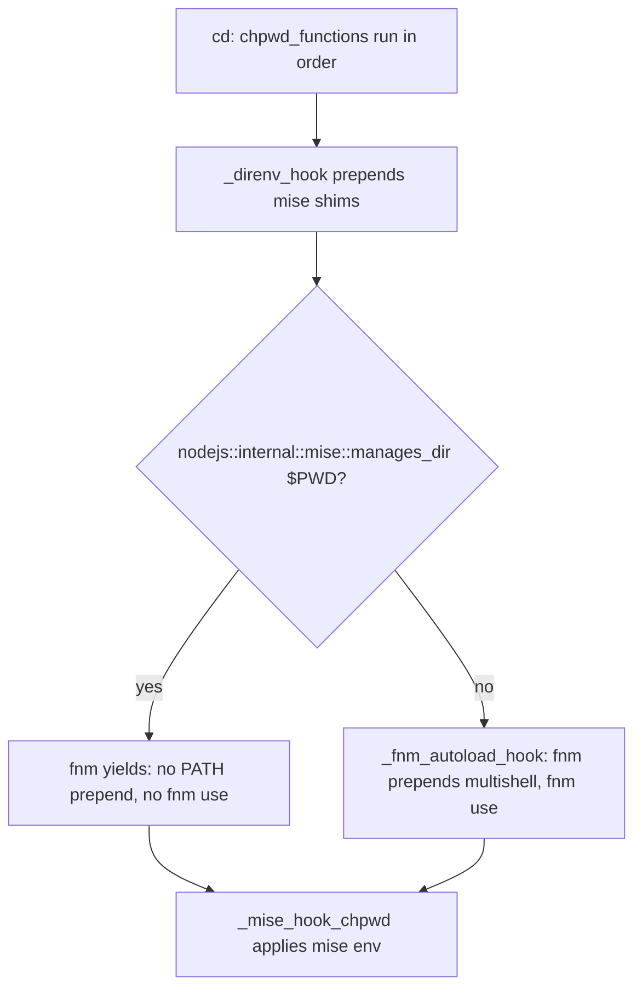

# Design

## Context

The dotfiles zsh configuration ships two version managers with no awareness of each other: fnm (nodejs module) and mise (devops module, `mise activate zsh` in `zsh/modules/devops/internal/mise.zsh:4-11`, called at source time on `:49-51`). Mise-managed project repositories add a third actor — direnv, whose `.envrc:4-7` prepends `$HOME/.local/share/mise/shims` to PATH.

Verified `chpwd_functions` order on `cd`: `_direnv_hook` → `issues::provider::factory` → `_fnm_autoload_hook` → `__pazi_add_dir` → `__rvm_cd_functions_set` → `_mise_hook_chpwd`.

Consequences of that order:

- `_direnv_hook` runs first, so mise shims from `.envrc` are already in PATH when the fnm hook runs.
- `_fnm_autoload_hook` runs BEFORE `_mise_hook_chpwd`, so any environment state maintained by mise still reflects the previous directory at the moment fnm decides — mise env vars cannot be used for the guard decision.
- `_mise_hook_chpwd` runs last, but by then fnm has already put its multishell bin ahead of the mise entries.

fnm activation itself is unconditional: `nodejs::internal::fnm::load` (`zsh/modules/nodejs/internal/base.zsh:11-17`) prepends `FNM_PATH` and evaluates both `fnm env` and `fnm env --use-on-cd --shell zsh`; `zsh/modules/nodejs/internal/main.zsh:22` calls it at source time and `:25` auto-installs fnm if missing. The `~/.zshrc:121-127` duplicate block re-runs `fnm env` a second time at startup.

Shell code in this repository must stay bash 3.2 portable (docs/contributing.md:81-95): POSIX `[ ]` tests only, no `[[ -v VAR ]]`, no `${var,,}`, no associative arrays — the nodejs module files carry `# shellcheck shell=bash` and are checked by pre-commit. See proposal.md Why for the full drift mechanism.

## Goals / Non-Goals

**Goals:**

- In mise-managed directories, mise shims win PATH precedence and `node` resolves to the mise pin (24.20.0).
- In directories without mise config, fnm behaves exactly as today — per-directory fnm switching (`--use-on-cd`) keeps working.
- Detection is cheap, shell-portable, and adds no new runtime dependency.
- `mise-check-versions` fails when interactive PATH shadowing is present.

**Non-Goals:**

- Removing fnm or standardizing entirely on mise (option 3 — deferred, see Decisions).
- Changing mise activation, direnv `.envrc` files, or the `chpwd_functions` order of other modules.
- Version-controlling `~/.zshrc` — it stays an untracked local file; only a manual removal/guard step is documented.
- Changing the `.task/remote/…node.Taskfile.yml:19-30` fnm expectations (follow-up with option 3).
- Deriving `NODEJS_VERSIONS` from `mise.toml` automatically (manual alignment only).

## Decisions

**Option 1 (chosen): fnm yields to mise.** fnm activation and its `--use-on-cd` hook become conditional so that when mise manages the directory, mise shims win the PATH and `_fnm_autoload_hook` must not re-prepend over them. fnm remains available globally for projects that do not use mise.

**Detection: walk-up config-file check, not env vars.** The guard is a helper (`nodejs::internal::mise::manages_dir`) that walks from `$PWD` upward checking each directory for `mise.toml`, `.mise.toml`, or `.tool-versions`, stopping at the first match, at `$HOME`, or at `/` — mirroring mise's own upward config discovery. The check uses only POSIX `[ -f ]` tests and `${dir%/*}` parameter expansion, so it stays bash 3.2 portable (docs/contributing.md:81-95: no `[[ -v ]]`, no `${var,,}`, no associative arrays). Rejected alternatives: `mise active` — no such subcommand exists (`mise active` → unknown command); `MISE_SHELL` — set globally by `mise activate zsh` at shell start, not per directory; `$__MISE_*` / `MISE_DIR`-style env vars — written by `_mise_hook_chpwd`, which runs AFTER `_fnm_autoload_hook` in `chpwd_functions` order, so at guard time they describe the previous directory; PATH introspection (checking whether mise shims precede fnm) — circular and order-dependent.

**Guard lives at two points.** (1) Inside `nodejs::internal::fnm::load` (`base.zsh:11-17`): when `manages_dir` reports true for `$PWD`, the `FNM_PATH` binary prepend stays (it exposes only the `fnm` executable and never shadows `node`) but the `fnm env` PATH prepend of the multishell bin is skipped, so startup inside a mise-managed directory never puts fnm ahead of mise. (2) Around `_fnm_autoload_hook`: after `eval "$(fnm env --use-on-cd --shell zsh)"` registers the hook, it is replaced in `chpwd_functions` by a guarded wrapper that re-checks `manages_dir` on every `cd` — in a mise-managed directory it returns without re-prepending (mise shims added earlier by `_direnv_hook` stay in front); otherwise it delegates to fnm's original autoload behavior, lazily running the `fnm env` eval on first use if load-time activation was skipped. Load-time-only guarding is insufficient because a shell started outside a mise directory can `cd` into one; hook-only guarding is insufficient because a shell started inside one is already shadowed before any `cd`.

**Align `NODEJS_VERSIONS` / `NODEJS_VERSION_GLOBAL` to 24.20.0 (explicit task).** fnm must keep serving non-mise directories, so its default alias is aligned to the `mise.toml:8` pin instead of being removed — until fnm itself is removed (option 3), the two managers must not disagree. Rejected for now: dropping the fnm pins and making mise the sole source of truth — that is option 3 territory and depends on the fnm consumers noted below.

**Harden `mise-check-versions` with an assertion outside `mise exec` (explicit task).** `Taskfile.yml:302-337` currently runs all assertions inside `mise exec`, which rebuilds PATH and therefore cannot observe interactive shadowing. The added second assertion compares `command -v node` / `node --version` using the ambient PATH (no `mise exec`) against the `mise.toml` pin and fails when `node` resolves under an fnm path (`fnm_multishells` or `~/.local/share/fnm`).

**Option 2 (rejected as primary): remove the duplicate `~/.zshrc` block and drop `--use-on-cd`.** Removing `~/.zshrc:121-127` and the `--use-on-cd` registration would reduce the number of chpwd participants, but it loses per-directory fnm switching outside mise-managed projects, and `~/.zshrc` is a regular file outside git control, so the change is manual and non-versioned. The duplicate block must be removed or guarded REGARDLESS — it re-runs `fnm env` a second time after module load and would re-establish fnm-first PATH even with the module guard in place — but it is documented as a manual step, not the primary mechanism.

**Option 3 (deferred): remove fnm entirely, standardize on mise.** Rejected for now because `.task/remote/…node.Taskfile.yml:19-30` still expects fnm (`check:fnm` precondition, `fnm install` / `fnm use`). Noted as follow-up: remove fnm from the nodejs module and the remote node Taskfile expectations together.

## Risks / Trade-offs

- [The walk-up check misses exotic mise config names (JSON variants, `mise/config.toml`)] → The guard covers the three canonical names (`mise.toml`, `.mise.toml`, `.tool-versions`); unknown names fall back to today's fnm-first behavior — no regression.
- [A directory has mise config but the `mise` binary is missing, and yielding leaves `node` unresolvable] → Only yield when `manages_dir` is true AND `mise` is available (`core::exists mise`); otherwise fnm keeps serving node.
- [Guard wrapper depends on fnm's `--use-on-cd` internals (`_fnm_autoload_hook` name)] → Register the wrapper by name after the eval and verify presence in `chpwd_functions`; a fnm upgrade renaming the hook degrades to no-guard, detected by task 5.3.
- [`~/.zshrc:121-127` re-runs `fnm env` after module load, re-establishing fnm-first PATH regardless of the module guard] → Manual removal/guard step (task 2); the file is untracked, so git cannot enforce it.
- [PATH strip/restore churn when crossing mise boundaries] → Only `*/fnm_multishells/*/bin` entries are touched, and only on directory-class transitions; the fnm binary dir (`FNM_PATH`) is never removed.
- [Version pins live in three places (`mise.toml` 24.20.0, `NODEJS_VERSIONS` 24.11.1, `.nvmrc`)] → Task 3 aligns the fnm pins to 24.20.0; consolidating pin sources is deferred with option 3.
- [Hardening assertions depend on the shell that invokes `task`; a clean non-interactive invocation may not exhibit shadowing] → The assertion is a tripwire for interactive drift: when `node` resolves outside `mise exec`, it must match the pin and must not resolve under an fnm path.
